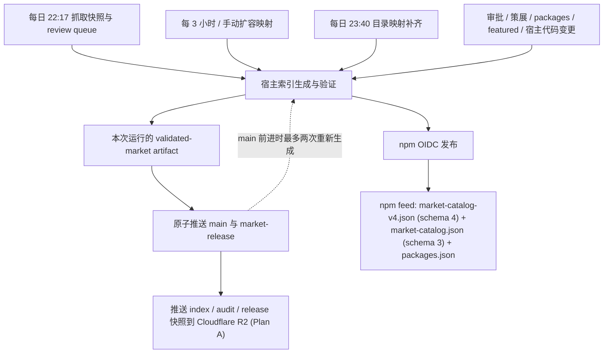

# CI 与发布流程

所有时间均为 Asia/Singapore（UTC+8）。GitHub 定时运行可能延迟，不能靠时间先后表达依赖。



图中的跨工作流箭头使用 `workflow_run`，只接受成功的 main 运行。所有数据源变更与补映射任务均先汇入宿主索引，再由宿主索引串联 Cloudflare R2 镜像与 npm feed 发布，避免 `entries[]` 与 `subscription` 口径分裂。最长正常链为「快照/扩容/补齐 → 宿主索引 → npm feed」（深度 2，低于 GitHub 三层级联限制）。`publish-r2` 是 `continue-on-error`：上传失败只留 `::error::` 标注，不会让宿主运行变红、导致网关的 GitHub 路径拒绝已发布的新版本；上传后会逐个回读校验，全部一致才翻转 `latest.json`。宿主索引运行失败时 npm feed 仍按 main 上已发布的索引发布，避免已合入的映射/精选改动被挡住；下一次成功刷新会重新对齐两者。

`GITHUB_TOKEN` 提交不会触发一般的 `push` 工作流，因此不能用「扩容/补齐提交 packages.json → push」衔接发布。显式 `workflow_dispatch` 可以使用该 token，宿主冲突恢复用它发起全新运行。

| 工作流文件 | 触发 | 职责 |
| --- | --- | --- |
| `update-catalog.yml` | 每日 22:17、手动 | 更新快照、待审核队列；同 owner 改名触及策展时自动同步目录页面；不自动审批 |
| `expand-subscription-mappings.yml` | 每 3 小时、手动 | 在网关字节预算内补充可核实映射（共享 skips 清单）、去重保存待复核项目；成功后衔接宿主索引 |
| `fill-catalog-mappings.yml` | 每日 23:40、手动 | 按星级补齐目录安装映射；成功后衔接宿主索引 |
| `refresh-host-market.yml` | 快照/扩容/补齐成功、策展/映射/宿主代码变更、每日 22:47、手动 | 重建紧凑格式官方索引；独立 publish job 验证 artifact 后原子发布 `main` 与 `market-release`，随后 `publish-r2` 推送 index、audit、release 快照至 Cloudflare R2（网页 catalog 由网关派生） |
| `publish-npm-feed.yml` | 宿主索引成功、feed 脚本变更、手动 | 仅跑快速数据校验（validate-packages / validate-market-catalog）、digest 去重、OIDC 发布（含 schema 4 精简版与 schema 3 兼容版），刷新 jsDelivr 缓存并触发 npmmirror 同步（失败只告警）；超时 10 分钟。重型回归测试只在 `validate-curated.yml` 中运行 |
| `refresh-showcase.yml` | SHOWCASE.md 变更、手动 | 更新中英文 README 展示区 |
| `reverify-packages.yml` | 每周一 23:33、手动 | 在线复核映射；仅报告，不改映射 |
| `validate-pr.yml` | PR 打开、更新、改标题/标签等 | 从 base 执行规则校验，不执行 PR 代码 |
| `validate-curated.yml` | 相关 PR、main 脚本/工作流变更、手动 | actionlint、两组测试（含 feed 发布/提取回归测试，publish-npm-feed 不再重复运行）、在线策展校验、目录同步及 feed 生成验证 |
| `validate-curation-push.yml` | main 审批/策展变更、手动 | 直接合入 main 时的策展与目录同步兜底 |

## 并发和故障恢复

- 各写入工作流保留独立 concurrency group；共享一个组会让不同类型的 pending 任务相互淘汰。工作流开始时读取最新 main，避免队列中旧事件生成旧数据。
- npm feed、展示页、快照和扩容推送最多尝试三次。遇到 main 前进时，从新 tip 重新生成；扩容重试保留 GitHub API token。最后一次失败后不再生成一份不会推送的数据。
- 宿主发布始终使用本次验证的 artifact，`main` 和 `market-release` 同时推进；不 rebase 或强推旧产物。main 前进导致失败时，显式排队全新生成，最多自动重试两次。权限错误、dispatch 失败、重试耗尽仍报红。排队成功只表示已交接，需查看后续运行确认最终发布。
- npm 发布串行完成；digest 相同则退出，版本冲突由现有脚本重新读取 registry 并重试。取消运行不能撤销已经发送的 registry 请求。
- 工作流校验不等于发布前统一审批门：独立的 main 校验和发布入口可能并行。保护规则、npm trusted publisher 配置、外部服务可用性仍由实际远端运行确认。

## 本地检查与维护

使用 Node.js 22：

```sh
npm ci --ignore-scripts --prefix scripts/host-market
node --test scripts/test-*.mjs
npm test --prefix scripts/host-market
node scripts/validate-curated.mjs --from-snapshot
node scripts/merge.mjs --check
node scripts/validate-packages.mjs
```

CI 的策展校验使用 GitHub API；`--from-snapshot` 只适用于本地离线验证。宿主测试会启动临时 localhost HTTP 服务。`workflows.test.mjs` 检查触发链无环、深度及 bot 提交后的发布衔接；`publication.test.mjs` 用临时 bare Git 仓库验证原子推送、main 并发更新、权限拒绝和重试上限。

若 `merge.mjs --check` 报目录漂移，运行 `node scripts/merge.mjs`，检查并提交目录、榜单、README 自动区域及 stats 的生成差异；不要绕过同步检查。它会沿用现有审批结果，不新增审批。快照变化可引起分类和计数漂移，因此这一检查可能再次提示需要同步。

若 packages 校验报仓库消失或改名，核实上游后修正映射，不能为了让发布变绿而静默删除记录。网络、源包完整性、数量熔断等失败仍应阻断发布。日常定时任务不能保证外部依赖永远成功。

GitHub 机制参考：[工作流触发与 GITHUB_TOKEN](https://docs.github.com/en/actions/how-tos/write-workflows/choose-when-workflows-run/trigger-a-workflow)、[workflow_run 级联限制](https://docs.github.com/en/actions/reference/workflows-and-actions/events-that-trigger-workflows#workflow_run)。
